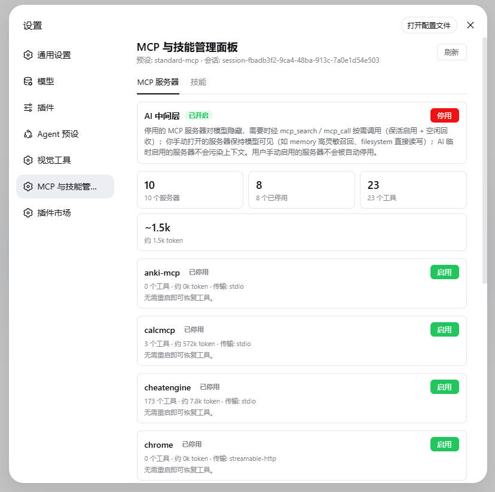

<p align="center">
  <strong style="font-size: 2.2em">🧩 MCP & Skill Manager</strong><br>
  <span style="font-size: 1.1em">DeepSeek Harness (DSH) Web plugin · Real-time enable/disable for MCP servers & Skill catalog · Optional AI middle layer (on-demand calls)</span>
</p>

<p align="center">
  <strong>English</strong> · <a href="./README.md">🌐 中文</a>
</p>

<p align="center">
  
  
</p>

---

## ✨ What it is

A settings-page panel that turns your **MCP servers** and **Skill catalog** into an actionable list: one toggle per entry — **disabling releases context usage instantly, enabling works without a restart**.

It also ships an optional **AI middle layer** (`autoManage`): tools of in-scope MCP servers are hidden from the model, which reaches them on demand via `dsh_mcp_search` / `dsh_mcp_call` (keep-alive enable → in-plugin execute → idle 30s auto reaping); servers *you* enabled can stay visible — your toggles decide exactly what the model context pays for.

```sh
# Quick install (in a DSH profile directory, e.g. ~/.dsh/profiles/web; git source is always the latest)
dsh plugin --profile web add "github:lilyblessing/dsh-mcp-skill-panel#main"
```



## 🎯 Core features

- 🟢 **Real-time MCP toggle**: disable → the loader entry is disposed (connection closed + all `mcp__<server>__*` tools unregistered), schema tokens freed instantly; enable → reconnect + tools restored, **no DSH restart**.
- 🧠 **Skill toggle**: injects/removes `disable-model-invocation: true` in SKILL.md frontmatter; the model catalog updates in real time.
- 🤖 **AI middle layer (optional)**: hidden servers stay invisible to the model; the model wakes tools on demand via `dsh_mcp_search` / `dsh_mcp_call`, auto-reaped after 30s idle; your manual toggles are never overridden by the model.
- ⏱️ **Prompt Cache friendly**: manual toggles can apply **immediately** or **at next session** (zero cache invalidation, zero extra fees); on-demand middle-layer calls never trigger a cache miss.
- 📁 **Project-level MCP & tool-level disable**: reads workspace-specific `.dsh/mcps` (visible only to that workspace's sessions); individual tools can be disabled inside a server — filtered from search, rejected on call.
- ➕ **Quick migration & skill creation**: paste Claude Code / Codex `mcpServers` JSON to convert and import in one click; create skills right in the panel.

## 📦 Installation & Upgrade

> 🎯 **Requires** DSH `0.2.1-rc.2` or later.
> ⚠️ **Important**: you **must restart `dsh web`** after installing or upgrading the plugin (the bundle injection layer is composed only at host startup).

### 1. Git source (recommended / latest features)

Run in a DSH profile directory (e.g. `~/.dsh/profiles/web`):

```sh
dsh plugin --profile web add "github:lilyblessing/dsh-mcp-skill-panel#main"
```

Prebuilt artifacts are committed (`lib/`), no local build needed. **Upgrade**: run `pnpm update dsh-mcp-skill-panel` in the profile directory to pull the latest build.

> ⚠️ `pnpm add` does **not re-resolve the same git spec** — upgrading a git-source install requires `pnpm update`; repeating `pnpm add` will not fetch new code.

### 2. npm package

```sh
pnpm add dsh-mcp-skill-panel@latest
```

> ⚠️ The npm `latest` tag is **0.6.0**, behind this branch's **0.7.0** (the PTC adaptation and other new features are not in it) — use the git source above for 0.7.0.

### 3. Local development link

```sh
npm run build && node scripts/deploy-link.mjs    # or combined: node scripts/deploy-link.mjs --build
```

The script deploys the build into `.deploy/` (outside the repo tree, so the dev `node_modules` cannot shadow `@deepseek-ai/*` resolution) and creates a Junction link in the profile directory — follow the script's instructions.

## 🚀 Quick Start

1. **Open the panel**: after restarting DSH, open the web page — "MCP & Skill Manager" appears on the left of the Settings page.
2. **Manage MCP**: in the "MCP Servers" tab check status and token usage, toggle with one click; expand a row's tool list to disable tools individually.
3. **Turn on the AI middle layer**: flip the "AI Middle Layer" switch — in-scope MCP servers are hidden from the model, which searches and calls them on demand.
4. **Import external config**: "Add MCP" → paste `mcpServers` JSON; env vars and transport types are detected automatically; import as global or project-level.

## 🏗️ Operation Modes & AI Middleware

| Mode | Switch | Model-facing behavior | Best for |
| --- | --- | --- | --- |
| **Mode 1: direct** | `autoManage: false` | Native tools (`mcp__*`) of every enabled MCP are injected directly | Fixed toolset, latency-sensitive |
| **Mode 2: middle layer** | `autoManage: true` | Tools of in-scope MCP servers are hidden; only `dsh_mcp_search` / `dsh_mcp_call` are exposed | Many MCP servers, tight context budget |

### `middleLayerHides`: middle-layer hidden range (default `'all'`)

| Value | Panel label | Semantics |
| --- | --- | --- |
| `'disabled'` | Manually disabled servers only | Tools of disabled servers are not exposed; **enabled servers' tools are fully exposed for direct calls** |
| `'all'` | All MCP servers | **No server tools are exposed at all**; the model takes everything through `dsh_mcp_search` / `dsh_mcp_call` |

> This setting only changes this turn's assembly visibility — the tool registry and the `dsh_mcp_call` execution path are unaffected. See [docs/architecture.md](./docs/architecture.md) for the assembly filter and call sequence.

## 🤖 Behavior under PTC (`mode: ptc`)

Since DSH `0.2.1-rc.2`, an agent preset can set `mode: ptc`: the model can only call `run_code` directly, and MCP tools move into the `tools:sdk` prompt section (no longer through `assembly.tools`). This plugin's hiding applies to the `tools:sdk` section **as well** — in-scope MCP tools do not enter the SDK tool table under PTC either; the middle layer's inner dispatch (`dsh_mcp_call` executing an MCP tool) carries `parent` / `rootCallId`, satisfying PTC's nested-call convention, and direct-call interception is unchanged.

## ⏱️ Timing & Prompt Cache

| Setting | Takes effect | Prompt Cache impact | Recommended when |
| --- | --- | --- | --- |
| **Immediate** (default) | Next conversation turn | The session's prefix cache is invalidated (miss rate ≈ 5–12.5× the hit rate) | You must free context or gain tools right now |
| **Next session** | Before the first request of a new session / on restart | **Zero invalidation, zero extra cost** | Routine maintenance, cost-sensitive |

> On-demand calls through the AI middle layer never trigger a cache miss. See [docs/prompt-cache.md](./docs/prompt-cache.md).

## 🔌 HTTP API Overview

The plugin serves the `/api/mcp-skill-panel` prefix (write operations require the `x-panel-token` header):

| Method | Path | Description |
| --- | --- | --- |
| GET | `/state?session=<id>&part=<mcp\|skills\|all>` | Snapshot of MCP & skill listings (session-scoped filtering supported) |
| POST | `/mcp/toggle` | `{ entryId, disabled }` toggles a single MCP server |
| POST | `/mcp/toolBulk` | `{ serverName, disabled, toolNames? }` bulk-enables/disables tools |
| GET/POST | `/config` | Read/write panel config (`autoManage` / `applyMode` / `middleLayerHides` / `toolBudget`) |
| GET | `/models` | Provider/model directory of the host LLM (per-model routing supported) |

> Full endpoint reference, quick-migration endpoints and ops/diagnostic endpoints: [docs/api.md](./docs/api.md).

## ⚠️ Important Notes & Limitations

- **Global preset scope**: toggles act at the preset layer — one server's switch affects all sessions under that preset.
- **Unregistered ≠ not enabled**: the "Not registered" badge means the child process is running but registered zero tools (missing project index, unreachable endpoint, etc.); the tool list under the card comes from the catalog snapshot.
- **Restart boundary**: plugin updates and config-intent materialization need a DSH restart to complete.
- **Control-tool arguments must be a JSON object**: a string form for `dsh_mcp_call`'s `arguments` is rejected up front by argument validation.
- **Known conflict with auto-review**: when the "auto review" preset (`dsh-experimental-auto-review`) is enabled, the middle layer's inner dispatch trips AR's PTC-convention check and fails; **this plugin does not patch AR** — waiting on upstream.
- More caliber boundaries and limitations: the "Known limitations (detailed)" section of [docs/architecture.md](./docs/architecture.md).

## 🛠️ Development

Dependencies are fully self-contained — no local DSH closure needed:

```sh
npm install --legacy-peer-deps --ignore-scripts   # install dependencies
npm run typecheck                                 # TypeScript type check
npm run build                                     # tsdown build + tsc declarations
npm run verify                                    # artifact integrity & architecture guards
npm run selftest:mcp                              # core pure-logic unit tests
```

> **lib/ artifacts are rebuilt by GitHub Actions** (committed back on `main` push) — see [docs/ci-build.md](./docs/ci-build.md).

## 📋 Changelog

For version history, breaking changes and past fixes see **[CHANGELOG.md](./CHANGELOG.md)**.
Current development version **0.7.0 (unreleased)**: PTC middle-layer adaptation (inner dispatch carries `parent`/`rootCallId`), `tools:sdk` section hiding under PTC (`middleLayerHides`), adaptation to `dsh-agent-preset-registry@0.2.1` (`livePresetMounts` removed), peer widened to `dsh-scope ^0.2.0-rc.2`, README refactor.

## 📄 License

[MIT](./LICENSE) © lilyblessing
