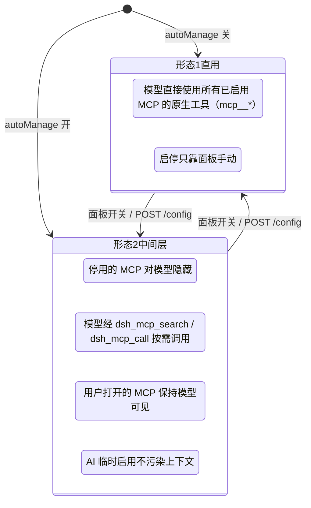
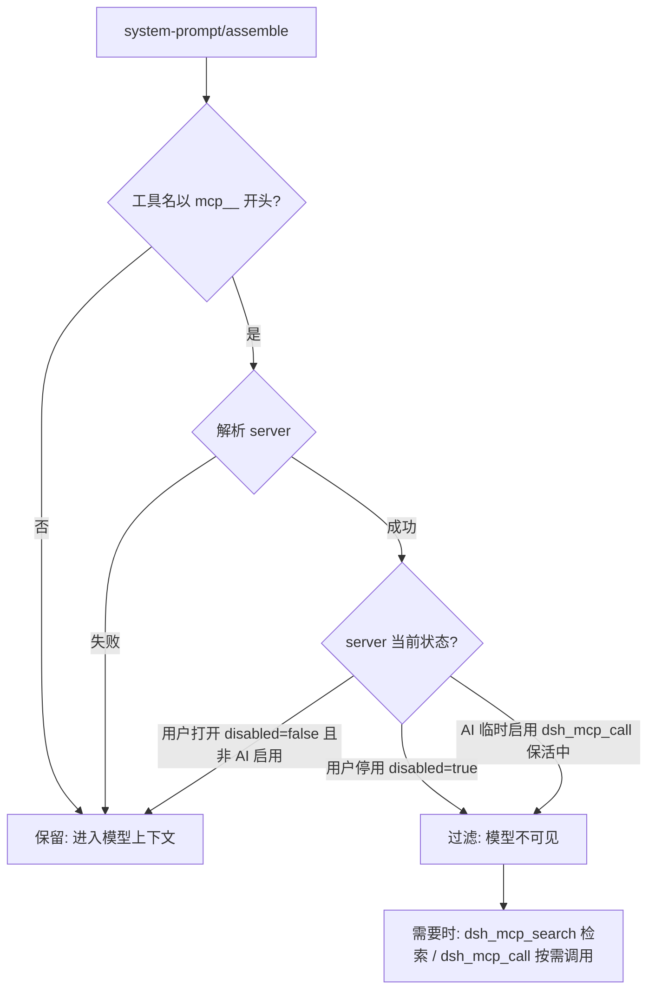
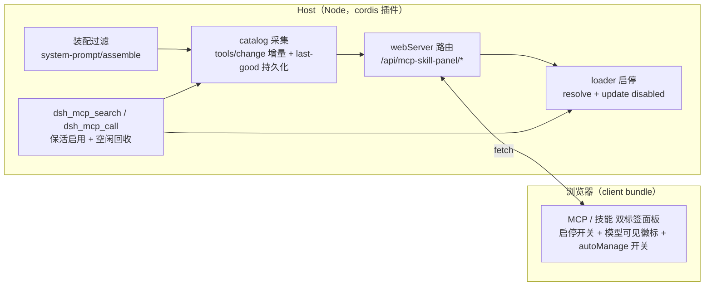
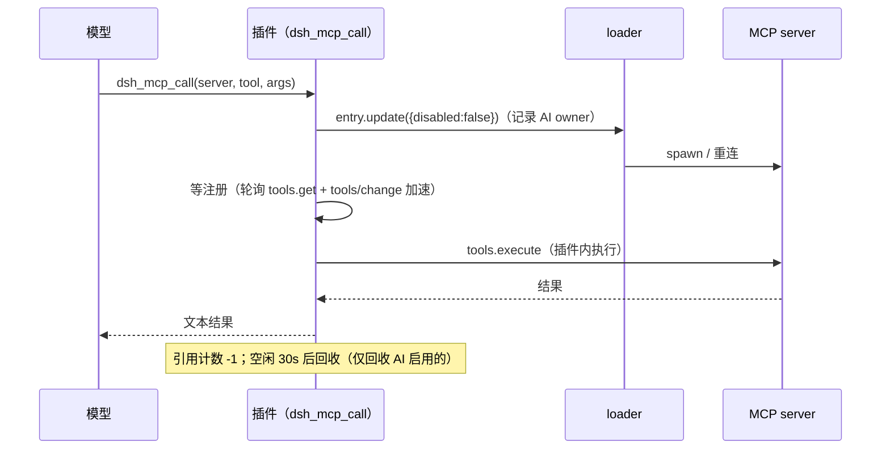

# 架构与深度设计

> 本文件内容迁自 README.md（2026-10-19 README 重构），原文保留；README 只留概览，返回总览请看 [README.md](../README.md)。

## 🏗️ 两种形态（面板上的「AI 中间层」开关）

形态 2 的装配过滤（每回合实时判定）：

**工具级禁用（v0.5.3+，常开）**：除上述 server 级过滤外，被禁用的单个工具从装配结果剔除、`dsh_mcp_search` 检索结果过滤、`dsh_mcp_call` 直接拒绝并提示「请在 MCP 管理面板打开该工具后再调用」；禁用集合持久化在 `state.json`，重启保持。

## ⚙️ 工作原理

**MCP 启停**：MCP 行是 agent preset 组合中的 loader entry（`@deepseek-ai/dsh-mcp-client`）。组合源在 0.2.0 是**声明式 preset bundle**（活体 = `dsh-preset-standard-mcp` 的 `cordis.patch.yml`），不再是 `~/.dsh/.agent-presets/<预设名>/agent.cordis.yml` 目录形态（旧目录已归档、0.2.0 无读取方）。0.2.0 的完整 id 形如 `agent-preset-registry:mcp-cheatengine`（前缀 = 配置里拥有该 PresetTree 的 entry id，随部署而变）；0.1.x 写的是 `include:agent-presets:mcp-cheatengine`。面板按 `serverName` / `options.id` 匹配、**不认字面前缀**，故前缀变化不影响功能。`loader.resolve(id).update({ disabled })` 实时 dispose/restart 该 entry。

**MCP 持久化为何分两步**：预设树（`PresetTree`）的 `write()` 是显式 no-op；toggle 只写插件状态文件，插件 `apply`（启动早期、standing 未挂载）时再把意图物化到预设文件。

> **注：「运行期绝不写预设文件」是 0.1.x 行为，0.2.0 已废弃。** 该铁律源于 0.1.x 的 `dsh-agent-presets`（复数包，0.2.0 已不存在）用 `{mtimeMs, size}` stamp 检测预设文件变化 —— **运行期写该文件会触发 standing 重挂而旧实例不清理**（serverName 全冲突、会话创建失败，0.1.0 实测事故）。0.2.0 的 registry / preset 两包已无 stamp / mtime / watch 逻辑，`@deepseek-ai/dsh-hmr` 也不监视 `link:` 目标目录，故改预设文件不再触发重挂事故；代价是**改后需重启 dsh 才生效**。两步走作为实现保留，但已非安全必需。

**中间层调用链**（`dsh_mcp_call` 对停用 server）：

> **tool 参数契约（0.5.1+）**：`dsh_mcp_call` 的 `tool` 应传该 server 上的**裸名**（如 `understand_image`）；误传 `dsh_mcp_search` 返回的注册全名（`mcp__<server>__<tool>`）或双重前缀会自动归一化，其他 server 的注册全名立即快速失败并提示。

> **控制工具名（0.6.0 起）**：两个控制工具为 **`dsh_mcp_search`** / **`dsh_mcp_call`**（旧名 `mcp_search` / `mcp_call` 已弃用 —— 上游网关把 `mcp_` 前缀当 MCP 工具解析并返回 400）。`CHANGELOG.md` 条目与 `decisions/`、`docs/*patch-notes*.md` 等历史留档中的旧名是当时的记录，未改写。

**catalog 采集**：`tools/change` 事件（root 监听，150ms 去抖）对 enabled server 增量快照；scope 解析经 `agentPresets.standingKeyFor()` 兜底并**进程级共享缓存**（v0.5.3，HTTP 面板路径与快照路径复用同一 key）；空快照不覆盖磁盘 last-good；`catalog.json` 原子写回（tmp + rename，0600）。

## ✅ 验证清单

| 检查项 | 操作 | 预期 |
| --- | --- | --- |
| 面板入口 | 重启后打开设置页 | 出现「MCP 与技能管理面板」，MCP/技能双标签，zh/en 跟随界面语言 |
| MCP 停用 | 关掉一个服务器开关 | 卡片变「已停用」，新会话工具列表不再含 `mcp__<server>__*`；停用态仍显示目录工具数 |
| MCP 启用 | 再打开开关 | 工具恢复，**无需重启** |
| 持久化 | 停用后重启 dsh | 该服务器仍处于停用状态 |
| Skill 启停 | 点技能开关 | 卡片立即翻转且不回跳；模型目录同步移除/恢复 |
| 外部变化 | 会话 A 停用某 MCP，会话 B 打开面板 | 无需点刷新即为最新状态 |
| AI 中间层 | 面板开 autoManage | 停用 server 对模型隐藏、`dsh_mcp_search`/`dsh_mcp_call` 可用；用户打开的 server 带「模型可见」徽标 |
| 回收保护 | 模型 dsh_mcp_call 后空闲 30s | AI 临时启用的 server 自动停用；用户手动启用的不被回收 |
| 工具级禁用 | 展开 server 工具列表关掉一个工具 | `dsh_mcp_search` 不再返回该工具；`dsh_mcp_call` 拒绝并提示；重启后保持 |
| 更多配置 | 点某行「更多配置…」改 `cwd` 等字段 | 热应用即时生效（子进程重启）；**重启 dsh 后**该字段出现在预设行 `config:` 块，且 live 从文件读回该值 |
| 未注册告警 | 让一个启用行的子进程起不来（如 codegraph 缺索引） | 卡片徽标显示「未注册工具 / Not registered」，`tools` 显示 0 而非目录快照值，悬停有说明 |
| 添加 MCP | 粘贴 mcpServers JSON → 预览 → 添加 | 全局写入 profile patch / 项目写入 `.dsh/mcps/mcp.json`，面板即时出现新行 |
| 创建技能 | 技能页「创建技能」 | 落盘 `~/.dsh/skills` 或项目 `.dsh/skills`，技能列表即时出现 |

## ⚠️ 已知限制（详表）

- 启停作用于 preset 层：一个服务器/技能的开关影响该 preset 下所有会话。
- 无 frontmatter 的 SKILL.md 无法切换（provider 本身会忽略此类文件）。
- 工具数/token 为估算值（`JSON.stringify(parameters).length / 4`），与模型注入面真实值近似。
- 停用后工具立即消失，但**当前回合的请求缓存**（如有）可能仍引用旧 schema；下一请求自然刷新。
- **持久化时滞**：启停实时生效；跨重启保持依赖下次启动的物化 —— 插件在「已有会话运行」期间被热更新时，本次进程不物化，下一次重启生效。
- **手动编辑预设组合文件的 mcp 行**（如手动移除 `disabled: true`）会令该行退出插件的**启停持久化管理**（下次启动尊重你的改动，不再写 `disabled`）；但**配置意图（「更多配置」改的字段）仍会继续物化**，两者是正交字段。
- **未注册 ≠ 未启用**：`status=failed / tools=0 / unregistered=true` 表示该行**已启用且在跑**，但子进程一个工具都没注册（多为配置问题：缺项目索引、端点不可达、可执行文件不存在）。卡片下方列出的工具来自目录快照，只是"可被 `dsh_mcp_search` 检索"，不代表当前可用。
- **工具级禁用边界**：禁用拦截作用于模型可见性（装配过滤）、`dsh_mcp_search` 检索与中间层 `dsh_mcp_call`；对已注册工具的直接原生调用（绕过中间层）不做运行时拦截。
- **有效统计是「工具级启用数」，不等于「实际进入上下文」**：它只扣「工具级禁用」（谓词与装配过滤同源）。**口径边界**：不扣 server 级隐藏（`dsh_mcp_call` 保活中的 AI 临时启用 server、`middleLayerHides='all'` 下的全部 server），也不扣 project-mcp 的工作区过滤 —— 它回答的是「该 server 有多少工具处于启用态」，不是「模型这一回合实际看到多少」。
- **工具预算的上限数字只是可配置默认值/示例**：`toolBudget` 与面板输入框占位符里的数字（如 Grok 350）是**示例值/默认提示**，不是对任何 provider 的真实断言或硬约束（各家上限随模型与账号变化，请按实测填）。预算比较用的「全部工具数」是**请求面口径优先**：`toolsAllSource='request'`（会话上一次已落盘请求的装配后工具表，有一轮延迟）；取不到时回退注册表口径 `'registry'` 并在卡片上标注来源，后者不扣 server 级隐藏与项目工作区过滤，是近似值。
- **控制工具的 `arguments` 必须是 JSON 对象**：`dsh_mcp_call` 的 `arguments` 声明为对象类型，**字符串形态会被参数校验前置拒绝**（报 `invalid arguments: "arguments" must be an object`）。这是有意的收紧（0.6.0 起）—— 旧版会把 JSON 字符串透明解析，现在按工具描述要求的对象形态传入即可。
- 运行期写 SKILL.md 安全（skill-filesystem 的 watcher 本就预期文件被改）；运行期写预设组合文件会触发 `dsh-agent-presets` 的 stamp 重挂事故【**0.1.x 行为，0.2.0 已废弃**：该包已不存在，新的 `dsh-agent-preset-registry` / `dsh-agent-preset` 无 stamp / watch 逻辑，改为「改后重启 dsh 生效」】，插件刻意不做（两步走实现保留）。
- 能力摘要表（`dsh_mcp_search` 空查询）只覆盖有 catalog 快照或配置了 `serverSummary` 的 server；从未成功启动过的 server（如 codegraph）不会列出。**口径提示**：`middleLayerHides='all'` 时该表按「经中间层取用」表述，不再宣称 server「对模型可见」—— 可见与否以装配结果为准（此时连已启用的 server 也从模型面隐藏）。
- **按模型覆盖的数据源（v0.6.0 补齐）**：面板**会**拉 provider/模型目录（`GET /models`，**60s TTL + 单飞**）—— 「无鉴权读端点不该把每次请求都放大到 adapter」仍是这条缓存的理由，但不再是「不拉目录」的理由。覆盖卡的行集合 = **可折叠的目录**（provider 行 + 模型行）∪ 其它已存在的键（运行期 ∪ 持久化（`autoManageByRoutePersisted`）；未被目录吃掉的键落在「其它键」区），因此**可以为任意 provider/模型预置规则，不必先切到它**；目录拉取失败时降级为「只列键」的旧行为，键照旧全部可见、可删（挂载失败后运行期表被清空的键，按「已保存，未生效」标注）。目录只影响**可点范围**，不影响 gate 语义（查表序 `provider/model` → `provider` → `autoManage` 与生效判定原样）。**会话口径（0.6.0 会话透传）**：面板**可用时**把当前会话一并带上（`/state`、`/models` 带 `?session=`；`/skill/toggle`、`/mcp/toolBulk` 带 body 的 `session`），host 就按该会话解析 —— 高亮、`toolsAll*` 计数、preset/cwd 等**随会话的读数**跟随你正在用的那个会话（**解析成功时**：卡片以 host 回显的 `sessionId` 为准，措辞据此在「跟随当前会话」/「面板绑定会话」之间切换）。注意 per-server 的 tools/tokens 聚合走**进程级** standing scope，不随会话。两个写端点用的是该会话的**作用域**：`/skill/toggle` 据此决定改哪个技能域（同名技能在不同会话下可能落到不同文件），`/mcp/toolBulk` 据此把工具名解析成实际目标。**取不到会话时**（宿主未提供该能力）请求与旧版**逐字节相同**，host 仍按 `roots[0]` 解析（见下条）。
- 面板是**进程级全局**设置区块：**可用时**它会带上当前会话（0.6.0 会话透传，见上条），高亮与随会话的读数（`toolsAll*` 计数、preset/cwd）跟随你正在用的会话（**解析成功时**，以 host 回显的 `sessionId` 为准）；**取不到会话时**才回退旧行为 —— `/state` 不带 `session`，host 侧按 `roots[0]` 解析归属会话。两种情形下卡片都会把 host 回显的 `sessionId`（没有则 `—`）显示出来供核对。
- **控制端点鉴权**：写操作由进程级随机令牌（`x-panel-token`）保护，仅面板同源客户端自动携带；GET 只读开放。宿主 webServer 本身无鉴权层，若将监听地址改为 `0.0.0.0` 对外暴露，建议同时依赖外层网络隔离。
