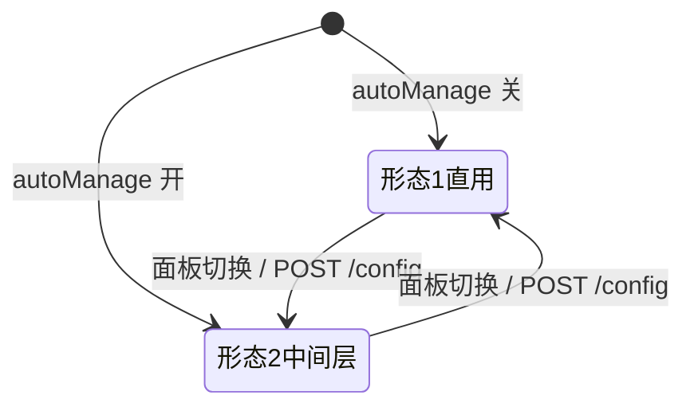

# 03 - `dsh-mcp-skill-panel` 重构版 README 草案与中英映射

本文件包含两部分：
1. **重构版 README 完整草案（中文）**：控制在 165 行（满足 ≤ 180 行要求，对比原版 450 行压降 63.3%），首屏 28 行覆盖全要素，严禁编造功能，完全基于现有事实编写。
2. **中英章节映射表（Section Mapping）**：供后续起草对齐英文文档时直接使用。

---

## 第一部分：重构版 README 中文草案

```markdown
<p align="center">
  <strong style="font-size: 2em">🧩 MCP 与技能管理面板</strong><br>
  <span>DeepSeek Harness（DSH）Web 插件 · MCP 服务器与 Skill 目录的实时启停 · 可选 AI 中间层按需调用</span>
</p>

<p align="center">
  <strong>中文</strong> · <a href="./README.en.md">English</a>
</p>

<p align="center">
  <a href="LICENSE"></a>
  <a href="./CHANGELOG.md"></a>
  <a href="https://www.npmjs.com/package/dsh-mcp-skill-panel"></a>
</p>

---

> **解决什么痛点**：MCP 服务器与技能随开随增，导致模型上下文严重膨胀、调用延迟上升。本插件把它们变成可操作的清单，**停用即释放上下文占用，启用无需重启**；开启 AI 中间层更可由模型按需临时拉起工具，实现真正的零常驻上下文浪费。

```sh
# 快速安装（在 DSH profile 目录，如 ~/.dsh/profiles/web）
pnpm add dsh-mcp-skill-panel@latest && dsh web
```


## ✨ 核心特性

- 🟢 **MCP 实时启停**：停用即卸载连接并注销工具，token 瞬时释放；启用重新连通，**无需重启 DSH**。
- 🧠 **Skill 启停**：向 frontmatter 注入/移除 `disable-model-invocation`，模型目录实时生效。
- 🤖 **AI 中间层（可选）**：开启 `autoManage` 后，停用项对模型隐藏；模型通过 `dsh_mcp_search` / `dsh_mcp_call` 按需临时唤醒工具，空闲 30s 自动回收。
- ⏱️ **Prompt Cache 友好**：支持「立即生效」与「下次会话生效」，后者零缓存失效、免额外计费。
- 📁 **项目级 MCP 与工具级禁用**：支持读取工作区专属 `.dsh/mcps`，可在 server 内部按工具逐个禁用。
- ➕ **快速迁移与技能创建**：支持粘贴 Claude Code / Codex 的 `mcpServers` JSON 一键转换导入；支持在面板新建技能。

## 📦 安装与升级

> 🎯 **环境要求**：适配 DSH `0.1.5-rc2`（或更高版本）。  
> ⚠️ **重要提示**：插件安装或升级后**必须重启 `dsh web`**（bundle 注入层仅在宿主启动时合成）。

### 1. npm 发布包安装（推荐）

在 DSH profile 目录（例如 `~/.dsh/profiles/web`）执行：
```sh
pnpm add dsh-mcp-skill-panel@latest
```
或直接通过 DSH CLI 挂载：
```sh
dsh plugin --profile web add dsh-mcp-skill-panel
```

### 2. Git 源码源安装（尝鲜最新特性）

```sh
dsh plugin --profile web add "github:lilyblessing/dsh-mcp-skill-panel#main"
```
*升级 Git 源*：在 profile 目录执行 `pnpm update dsh-mcp-skill-panel` 即可拉取最新构建产物。

### 3. 本地开发 Link 安装

```sh
npm run build && node scripts/deploy-link.mjs
```
随后按脚本提示将 profile 下的 `dsh-mcp-skill-panel` 目录通过 Junction 软链接至部署目录。

## 🚀 快速上手

1. **进入面板**：重启 DSH 后，访问浏览器 Web 页面，在「设置页」左侧即可看到「**MCP 与技能管理面板**」。
2. **管理 MCP**：在「MCP 服务器」标签页查看所有服务状态与 token 占用，点击右侧开关即可实时启停；点击行内可展开工具列表进行细粒度禁用。
3. **开启 AI 中间层**：打开页面上方的「AI 中间层」开关。停用的 MCP 将对模型隐藏，模型可自主按需搜索并临时调用。
4. **导入外部配置**：点击右上角「添加 MCP」，粘贴外部 `mcpServers` JSON 配置，自动识别环境变量与传输类型，一键导入为全局或项目级。

## 🏗️ 运行形态与 AI 中间层

| 形态 | 开关配置 | 模型调用特征 | 适用场景 |
| --- | --- | --- | --- |
| **形态 1：原生直用** | `autoManage: false` | 直接注入所有已启用 MCP 的原生工具（`mcp__*`） | 常用工具固定、对调用延时极度敏感 |
| **形态 2：AI 中间层** | `autoManage: true` | 停用项对模型隐藏，仅暴露 `dsh_mcp_search` / `dsh_mcp_call` | 挂载大量 MCP、需严控上下文预算 |


> 装配过滤机制与调用时序架构图详见 [docs/architecture.md](./docs/architecture.md)。

## ⏱️ 启停生效时机与费用建议

面板提供「生效时机」下拉选择，可根据对 Token 费用的敏感度灵活选择：

| 模式 | 生效时间点 | Prompt Cache 影响 | 推荐场景 |
| --- | --- | --- | --- |
| **立即生效**（默认） | 下一轮对话即刻生效 | 当前会话前缀缓存必定失效（Miss 费率约为 Hit 的 5~12.5 倍） | 必须立刻释放上下文或使用新工具 |
| **下次会话生效** | 新会话首次请求前 / 重启时 | **零缓存失效、零额外费用** | 日常维护配置，追求极致性价比 |

> 开启 AI 中间层（形态 2）按需临时调用 server 天然不触发缓存 Miss。原理详见 [docs/prompt-cache.md](./docs/prompt-cache.md)。

## 🔌 HTTP API 概览

插件提供 `/api/mcp-skill-panel` 前缀的 RESTful 控制接口（写操作需在 Header 携带 `x-panel-token`）：

| 方法 | 路径 | 功能说明 |
| --- | --- | --- |
| GET | `/state?session=<id>&part=<mcp\|skills\|all>` | 读取 MCP 与技能清单快照（支持按 session 作用域过滤） |
| POST | `/mcp/toggle` | `{ entryId, disabled }` 启停单个 MCP 服务器 |
| POST | `/mcp/toolBulk` | `{ serverName, disabled, toolNames? }` 批量启停指定工具 |
| GET/POST | `/config` | 读取与修改面板配置（`autoManage` / `applyMode` / `toolBudget`） |
| GET | `/models` | 查询宿主 LLM 的 provider 与模型目录（支持按模型独立分流） |

> 完整端点参数、快速迁移接口与运维排障端点详见 [docs/api.md](./docs/api.md)。

## ⚠️ 使用须知

- **全局预设作用域**：启停操作作用于 Preset 组合层，一个服务器的开关会影响属于该预设下的所有会话。
- **未注册 ≠ 未启用**：卡片显示「未注册工具」表示子进程正常运行但未导出工具（常见于工作区缺失索引或依赖），下方工具列表展示的是快照缓存。
- **重启生效边界**：更新插件代码或配置持久化意图物化时，需重启 DSH 方可完成生效。
- **控制工具参数规范**：AI 中间层 `dsh_mcp_call` 的 `arguments` 必须严格传 JSON 对象，不再兼容字面量字符串。

## 🛠️ 本地开发

依赖已完全自包含，无需本地 DSH 闭包：
```sh
npm install --legacy-peer-deps --ignore-scripts   # 安装依赖
npm run typecheck                                # TypeScript 类型检查
npm run build                                    # tsdown 构建 + tsc 生成声明
npm run verify                                   # 产物完整性与架构守卫校验
npm run selftest:mcp                             # 执行核心纯逻辑单测
```

## 📋 变更日志

详细的版本演进记录、破坏性变更声明与历史漏洞修复请参阅：  
👉 **[完整变更日志 (CHANGELOG.md)](./CHANGELOG.md)**

## 📄 开源协议

本项目基于 [MIT License](./LICENSE) 开源发布。
```

---

## 第二部分：中英章节映射表（Section Mapping）

当后续为英文读者编写 `README.en.md`（或将主文档设为 `README.md`）时，严格遵循以下章节对照：

| 序号 | 中文草案标题 | 建议英文标题 | 章节核心职责 |
|---|---|---|---|
| **0** | `🧩 MCP 与技能管理面板` | `# 🧩 MCP & Skill Management Panel` | 标头区、定位标语、状态徽标、首屏一键安装命令与 Hero 截图 |
| **1** | `## ✨ 核心特性` | `## ✨ Features` | 6 项核心优势要点列表（免重启启停、AI 中间层、Prompt Cache 优化等） |
| **2** | `## 📦 安装与升级` | `## 📦 Installation & Upgrade` | npm、Git 源、本地 link 三种安装命令，版本要求及重启须知 |
| **3** | `## 🚀 快速上手` | `## 🚀 Quick Start` | 1-2-3-4 交互步骤（打开面板、启停操作、中间层、导入添加） |
| **4** | `## 🏗️ 运行形态与 AI 中间层` | `## 🏗️ Operation Modes & AI Middleware` | 形态 1（原生直用）与形态 2（中间层）对比表 + Mermaid 状态机 |
| **5** | `## ⏱️ 启停生效时机与费用建议` | `## ⏱️ Timing & Prompt Cache` | 立即生效 vs 下次生效对比表、Prompt Cache 费用建议 |
| **6** | `## 🔌 HTTP API 概览` | `## 🔌 HTTP API Overview` | 常用端点表格（state, toggle, toolBulk, config, models）及鉴权说明 |
| **7** | `## ⚠️ 使用须知` | `## ⚠️ Important Notes & Limitations` | 4 条关键认知边界（Preset 作用域、未注册状态、重启机制、参数规范） |
| **8** | `## 🛠️ 本地开发` | `## 🛠️ Development` | 5 条自包含开发脚本（install, typecheck, build, verify, selftest） |
| **9** | `## 📋 变更日志` | `## 📋 Changelog` | 引导至独立 `CHANGELOG.md` 的跳转说明 |
| **10**| `## 📄 开源协议` | `## 📄 License` | MIT License 声明 |
